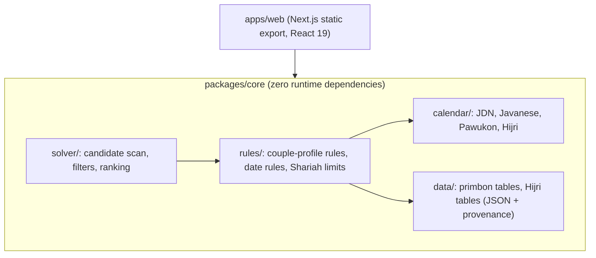

# System Architecture & Technical Implementation Blueprint
# Tanggal Baik Nikah — Javanese Tradition & Islamic Sunnah Wedding Advisor

**Document ID:** ARCH-TBN-2026-V2  
**Version:** 2.0.0  
**Status:** Approved for Implementation (supersedes v1.0.0)  
**Release Date:** November 2, 2026  
**Repository Workspace:** `D:\tanggal_baik_nikah`  
**Governing Standard:** [`AGENTS.md`](file:///D:/tanggal_baik_nikah/AGENTS.md)  
**Domain Source of Truth:** [`RESEARCH.md`](file:///D:/tanggal_baik_nikah/RESEARCH.md)

> [!IMPORTANT]
> v2.0 changes, all driven by the audit of November 2, 2026: (1) the solver no longer mixes couple-constant rules into date ranking; (2) the workspace shrinks from 4 packages to 2; (3) Dexie, Zod-in-domain, `@react-pdf/renderer` and the SHA-256 "privacy hash" are removed; (4) every golden anchor was recomputed and 7 wrong values were corrected; (5) Hijri dates come from bundled official tables with an astronomical forecast fallback.

---

## 1. System Overview & Invariants

`Tanggal Baik Nikah` is an offline-first, fully client-side web application. A pure TypeScript core computes three calendars (Gregorian, Sultan Agungan Javanese, Hijri), evaluates Javanese petungan rules transcribed in `RESEARCH.md`, and ranks candidate wedding dates. Islamic guidance is presented beside the adat results, never merged into one score.



### 1.1 Invariants
1. **Zero runtime dependencies in `packages/core`.** No date libraries. Integer arithmetic only (`Math.floor`, `%` normalised to non-negative). Same input → identical output on every JS engine.
2. **Data, not code, for manuscript tables.** Every primbon table lives in `packages/core/src/data/*.json` with a `provenance` block (source, page/rule number, transcriber, confidence tier, kurup assumption). Evaluators are generic lookups.
3. **Two layers that never mix.** Couple-profile rules (depend only on the couple) render in the Couple Profile panel. Date rules (depend on the candidate date) are the only input to ranking.
4. **No silent data.** A rule whose table is incomplete has `dataStatus: 'pending'`, is skipped by the solver, and is listed in the glossary as "belum ditranskripsi".
5. **Privacy.** No network request carries user input. Nothing is stored unless the user ticks "Simpan di perangkat ini" (localStorage). No telemetry.
6. **Offline.** After first load the app works with no connection.

---

## 2. Workspace Structure

```
tanggal_baik_nikah/
├── packages/
│   └── core/                          # @tanggal-baik/core — pure, framework-free
│       ├── src/
│       │   ├── calendar/
│       │   │   ├── jdn.ts             # Fliegel–Van Flandern + inverse
│       │   │   ├── weton.ts           # saptawara, pancawara, neptu
│       │   │   ├── javanese.ts        # Sultan Agungan calendar, kurup table
│       │   │   ├── pawukon.ts         # wuku, sadwara (d mod 6); hastawara/sangawara only when data verified
│       │   │   ├── sunset.ts          # NOAA solar algorithm for day-boundary shift
│       │   │   ├── hijri.ts           # table lookup + forecast fallback
│       │   │   └── month-grid.ts      # 42-cell tri-system grid
│       │   ├── data/
│       │   │   ├── primbon/*.json     # one file per rule (see RESEARCH.md §8)
│       │   │   └── hijri/*.json       # kemenag.json, khgt.json (1st day of each month)
│       │   ├── rules/
│       │   │   ├── registry.ts        # typed catalogue of all rule definitions
│       │   │   ├── couple/*.ts        # B-01, J-15, J-16, J-17, J-22, J-23, J-24, J-25, J-18..20
│       │   │   ├── date/*.ts          # J-07, J-08, J-11..14, J-26..36, U-01..U-05
│       │   │   ├── shariah.ts         # iddah, ihram limits + informational notes
│       │   │   └── profiles.ts        # tradition profiles (which rules are filters/criteria)
│       │   ├── solver/
│       │   │   ├── solve.ts           # scan → limits → filters → criteria → sort
│       │   │   └── explain.ts         # human-readable reasons per date
│       │   └── index.ts               # public API (only entry point)
│       └── tests/
│           ├── anchors.test.ts
│           ├── calendar.property.test.ts
│           ├── rules/*.test.ts
│           └── solver.test.ts
├── apps/
│   └── web/                           # Next.js 15, output: 'export'
│       ├── src/app/                   # /, /cari-tanggal, /cek-weton, /kalender, /glosarium
│       ├── src/components/
│       ├── src/lib/storage.ts         # opt-in localStorage
│       ├── src/lib/schemas.ts         # Zod: validates form input at the UI boundary
│       └── src/app/sw.ts              # Serwist service worker
├── pnpm-workspace.yaml
└── package.json
```

### 2.1 Boundary Rules
| Package | May import | Must never import | Runtime deps |
|---|---|---|---|
| `@tanggal-baik/core` | nothing | React, Next.js, Zod, any npm package | 0 |
| `apps/web` | `@tanggal-baik/core` (root export only), React, Next.js, Radix UI, Zod, Serwist, Lucide | `@tanggal-baik/core/src/*` sub-paths | standard web deps |

Enforced by ESLint `no-restricted-imports` plus `"exports"` in `packages/core/package.json`.

### 2.2 Why not more packages
Calendar, rules and solver change together and ship together. Directory boundaries plus the lint rule give the same isolation without three `package.json` files, three build steps and cross-package version drift.

---

## 3. Domain Types

```typescript
export type SaptawaraIndex = 0 | 1 | 2 | 3 | 4 | 5 | 6;      // 0 = Ahad
export type SaptawaraName = 'Ahad' | 'Senin' | 'Selasa' | 'Rabu' | 'Kamis' | 'Jumat' | 'Sabtu';
export type PancawaraIndex = 0 | 1 | 2 | 3 | 4;               // 0 = Legi
export type PancawaraName = 'Legi' | 'Pahing' | 'Pon' | 'Wage' | 'Kliwon';

export type WukuName =
  | 'Sinta' | 'Landep' | 'Wukir' | 'Kurantil' | 'Tolu' | 'Gumbreg' | 'Warigalit' | 'Warigagung'
  | 'Julungwangi' | 'Sungsang' | 'Galungan' | 'Kuningan' | 'Langkir' | 'Mandasiya' | 'Julungpujut'
  | 'Pahang' | 'Kuruwelut' | 'Marakeh' | 'Tambir' | 'Medangkungan' | 'Maktal' | 'Wuye' | 'Manahil'
  | 'Prangbakat' | 'Bala' | 'Wugu' | 'Wayang' | 'Kulawu' | 'Dukut' | 'Watugunung';

export type SasiJawa =
  | 'Sura' | 'Sapar' | 'Mulud' | 'Bakdamulud' | 'Jumadilawal' | 'Jumadilakir'
  | 'Rejeb' | 'Ruwah' | 'Pasa' | 'Sawal' | 'Dulkangidah' | 'Besar';
export type TahunWindu = 'Alip' | 'Ehe' | 'Jimawal' | 'Je' | 'Dal' | 'Be' | 'Wawu' | 'Jimakir';

/** 'kurup' = official Sultan Agungan reckoning with gugur sedina every 120 years (Asapon → Anenhing).
 *  'aboge' = community reckoning that kept Alip Rebo Wage without the 1866 J correction. */
export type JavaneseReckoning = 'kurup' | 'aboge';
export type KurupName = 'Aboge' | 'Asapon' | 'Anenhing';

export interface Weton {
  readonly dayIndex: SaptawaraIndex;
  readonly pasaranIndex: PancawaraIndex;
  readonly neptu: number;                 // 7..18
}

export interface JavaneseDate {
  readonly day: number;                   // 1..30
  readonly sasi: SasiJawa;
  readonly sasiIndex: number;             // 0..11
  readonly year: number;                  // e.g. 1960
  readonly tahun: TahunWindu;
  readonly kurup: KurupName;
  readonly isLongYear: boolean;           // Besar has 30 days
}

export interface PawukonPosition {
  readonly dayInCycle: number;            // d = (JDN - 146) mod 210
  readonly wukuIndex: number;             // floor(d / 7)
  readonly wuku: WukuName;
  readonly sadwara: 'Tungle' | 'Aryang' | 'Wurukung' | 'Paningron' | 'Uwas' | 'Mawulu';
}

export interface HijriDate {
  readonly day: number;
  readonly month: number;                 // 1..12
  readonly year: number;
  readonly authority: 'kemenag' | 'khgt';
  readonly basis: 'official' | 'forecast'; // forecast = computed, not yet ratified
}

export interface DayPoint {
  readonly jdn: number;
  readonly gregorian: { readonly year: number; readonly month: number; readonly day: number };
  readonly weton: Weton;
  readonly javanese: JavaneseDate;
  readonly pawukon: PawukonPosition;
  readonly hijri: { readonly kemenag: HijriDate | null; readonly khgt: HijriDate | null };
}

// ---------------------------------------------------------------- rules
export type RuleLayer = 'couple' | 'date' | 'shariah';
export type SourceTier = 'T0' | 'T1' | 'T1-L' | 'T2' | 'T3';
// T0 Qur'an & sahih hadith | T1 Betaljemur/Bektijammal transcribed from the printed edition
// T1-L Setiaji (Undip) Pati manuscript | T2 KHI, Kemenag, Muhammadiyah, NU | T3 secondary/web transcription

export interface RuleDefinition {
  readonly id: string;                    // 'J-12', 'B-01', 'U-01', 'S-01'
  readonly layer: RuleLayer;
  readonly nameJv: string;
  readonly summaryId: string;             // Indonesian UI copy
  readonly source: { readonly title: string; readonly locator: string; readonly tier: SourceTier };
  readonly dataStatus: 'verified' | 'secondary' | 'pending';
  readonly kurupAssumption?: KurupName;   // for tables that print day names
  readonly conflictsWith?: readonly string[];
}

export interface RuleOutcome {
  readonly ruleId: string;
  readonly verdict: 'pass' | 'fail' | 'info';
  readonly labelJv: string;               // e.g. 'Taliwangke', 'Pesthi'
  readonly explanationId: string;         // shows the arithmetic, e.g. '(28 + 16) mod 3 = 2'
}

// ---------------------------------------------------------------- solver
export interface TraditionProfile {
  readonly id: 'keraton' | 'pati' | 'populer' | 'custom';
  readonly filters: readonly string[];    // date rules that eliminate a date
  readonly criteria: readonly string[];   // date rules that count as "criteria met"
  readonly variantChoices: Readonly<Record<string, string>>; // e.g. { 'J-26/J-27': 'both' }
}

export interface CandidateResult {
  readonly day: DayPoint;
  readonly eliminatedBy: readonly RuleOutcome[];   // empty → date is eligible
  readonly criteriaMet: number;
  readonly criteriaTotal: number;
  readonly outcomes: readonly RuleOutcome[];
  readonly preferenceMatches: readonly ('syawal' | 'jumat' | 'akhir-pekan')[];
  readonly saat: readonly { readonly start: string; readonly end: string; readonly labelJv: string }[];
}
```

---

## 4. Algorithms

### 4.1 Gregorian ↔ JDN (Fliegel–Van Flandern)
```
a = floor((14 - M) / 12); y = Y + 4800 - a; m = M + 12a - 3
JDN = D + floor((153m + 2) / 5) + 365y + floor(y/4) - floor(y/100) + floor(y/400) - 32045
```
Inverse uses the standard Richards algorithm. Both are exhaustively round-trip tested for 1900-01-01 … 2200-12-31.

### 4.2 Weton
```
dayIndex     = (JDN + 1) mod 7        // 0 Ahad … 6 Sabtu
pasaranIndex = JDN mod 5              // 0 Legi … 4 Kliwon
neptu        = NEPTU_DAY[dayIndex] + NEPTU_PASARAN[pasaranIndex]
NEPTU_DAY     = [5, 4, 3, 7, 8, 6, 9]   // Ahad … Sabtu
NEPTU_PASARAN = [5, 9, 7, 4, 8]         // Legi … Kliwon
```
Weekend test: `dayIndex === 6 || dayIndex === 0`.

### 4.3 Sultan Agungan Javanese calendar
```
YEAR_LENGTH = [354, 355, 354, 354, 355, 354, 354, 355]   // Alip … Jimakir (Ehe, Dal, Jimakir long)
MONTH_LENGTH = [30, 29, 30, 29, 30, 29, 30, 29, 30, 29, 30, 29]  // Besar = 30 in long years

KURUP_EPOCHS (reckoning = 'kurup'):
  Aboge     1747 J  JDN 2385728  (Rabu Wage,    1819-10-20)
  Asapon    1867 J  JDN 2428252  (Selasa Pon,   1936-03-24)
  Anenhing  1987 J  JDN 2470776  (Senin Pahing, 2052-08-26)
Each kurup = 120 years = 42,524 days; the 120th year (a Jimakir) is shortened to 354 days.

reckoning = 'aboge': epoch JDN 2385728, no gugur sedina ever (2,835-day windu repeats forever).

toJavanese(jdn):
  1. pick the last epoch <= jdn (throw CalendarRangeError if jdn < 2385728)
  2. walk whole windu (2,835 days) then whole years, applying the 354-day rule to year 120 of the kurup
  3. walk months; day = remainder + 1
  4. tahun = TAHUN[(year - 1867) mod 8]  (also valid for 1747: (1747 - 1867) mod 8 = 0 → Alip)
```
Walking is O(windu count) ≤ 60 iterations for the supported range; no lookup tables needed.

### 4.4 Pawukon
```
d         = (JDN - 146) mod 210          // 0 = Ahad, wuku Sinta
wukuIndex = floor(d / 7)
sadwara   = SADWARA[d mod 6]             // Tungle, Aryang, Wurukung, Paningron, Uwas, Mawulu
```
Hastawara (padewan, 8) and Sangawara (padangon, 9) need the irregular repeats documented in `RESEARCH.md §2.6`. They ship only after the anchor tests in §6.1 pass against an external almanac; until then the UI omits them.

### 4.5 Day boundary (sunset)
Javanese and Hijri days begin at sunset. For a birth time after local sunset, the weton and Javanese/Hijri date advance by one day while the Gregorian date stays. Sunset is computed with the NOAA solar-position algorithm for the user's chosen kabupaten (default Yogyakarta, −7.80°, 110.37°). When the birth time is unknown and the date is entered, the UI shows both wetons if needed for the user to choose. Wedding dates are daytime events and use the civil date.

### 4.6 Hijri dates
1. Look up `data/hijri/kemenag.json` and `data/hijri/khgt.json`: arrays of `{ year, month, startJdn }` for every month that has an official/published start date (source URL per row).
2. Outside the table range, compute a forecast: new-moon conjunction (Meeus ch. 49) and moon altitude/elongation at sunset (Meeus ch. 47) at the reference location; apply MABIMS (altitude ≥ 3°, elongation ≥ 6.4°) or KHGT (altitude ≥ 5°, elongation ≥ 8° anywhere on Earth before 24:00 UTC, with Muhammadiyah's published supplementary conditions). Mark `basis: 'forecast'`.
3. The UI always labels forecasts ("prakiraan hisab, menunggu sidang isbat").

---

## 5. Rules and Solver

### 5.1 Rule layers
| Layer | Examples | Used for |
|---|---|---|
| `couple` | B-01 (8 categories, `mod 9`), J-15, J-16, J-17, J-22, J-23, J-24/25, J-18..20 | Couple Profile panel only |
| `date` | J-07, J-08, J-11, J-12, J-13, J-14/J-30, J-26/J-27, J-28, J-29, J-31, J-32, J-33, J-34, U-01..U-05 | Filters and criteria (per profile) |
| `shariah` | S-01 iddah end date, S-02 ihram | Hard limits (only when the user supplies them) |
| info | I-01..I-08 (tawhid, Shawwal, Friday, walimah, istikharah, KHI rukun) | Islamic panel text |

### 5.2 Tradition profiles (default rule sets)
| Profile | Filters (eliminate) | Criteria (counted) |
|---|---|---|
| `keraton` (Betaljemur) | J-07, J-08, J-12, J-13, J-26/J-27 (user picks A, B, or both), J-28, J-29, J-31, J-32, personal U-02..U-04 | J-11, J-33 primary month, J-34 3-table agreement |
| `pati` (Setiaji manuscript) | U-01, U-02, U-03, U-04, U-05 | J-12, J-33 |
| `populer` | J-07, J-08, J-32, U-02, U-04 | J-12, J-33, U-01 |
| `custom` | user-selected | user-selected |

Rules with `dataStatus: 'pending'` are silently dropped from every profile and listed under "Aturan yang belum aktif".

### 5.3 Solver pipeline
```
solve(input):
  1. candidates = every JDN in [start, end] matching the day filter (weekends / all / custom weekdays)
  2. for each candidate:
       a. Shariah limits: before iddah end or inside an ihram window → eliminatedBy += S-xx
       b. profile filters → eliminatedBy += every failing rule (evaluate all, do not stop at first)
       c. profile criteria → criteriaMet / criteriaTotal
       d. preferences (user-chosen tie-breakers): Syawal (Kemenag Hijri month 10), Jumat, akhir pekan
       e. saat ijab windows (J-35/J-36) when data verified
  3. eligible = candidates with empty eliminatedBy
  4. sort eligible by: criteriaMet desc → preferenceMatches.length desc → JDN asc
  5. return { eligible, eliminated (with reasons), coupleProfile, inactiveRules }
```
Complexity: ≤ 366 candidates × ~25 rules; target < 20 ms on a mid-range phone.

### 5.4 Presentation of results
- Primary label: "Memenuhi 3 dari 3 kriteria adat" — a count, not stars, not percentages.
- Every eliminated date stays visible in a collapsible "Tanggal yang gugur" list with reasons ("29 Besar 1960 — Kunarpaning Warsa, Betaljemur no. 7").
- Couple Profile panel shows each couple rule with its arithmetic, its source tier, and a fixed note: the result has no bearing on the validity or fate of the marriage (KHI Pasal 14; HR. Tirmidhi 1614).
- When Shawwal is preferred but the profile eliminates its weekends (J-26 forbids Sabtu & Ahad in Sawal), the UI names this conflict explicitly.

---

## 6. Test Strategy

### 6.1 Golden anchors (recomputed November 2, 2026)
| ID | Gregorian | JDN | Weton | Wuku | Javanese date | Purpose |
|---|---|---|---|---|---|---|
| A-01 | 1945-08-17 | 2431685 | Jumat Legi | Manahil (#22) | 9 Pasa 1876 Ehe | National anchor |
| A-02 | 1936-03-24 | 2428252 | Selasa Pon | Langkir (#12) | 1 Sura 1867 Alip (Asapon) | Asapon epoch |
| A-03 | 2052-08-25 | 2470775 | Ahad Legi | Kulawu (#27) | 29 Besar 1986 Jimakir | Last Asapon day (dropped leap day) |
| A-04 | 2052-08-26 | 2470776 | Senin Pahing | Kulawu (#27) | 1 Sura 1987 Alip (Anenhing) | Anenhing epoch |
| A-05 | 1819-10-20 | 2385728 | Rabu Wage | — | 1 Sura 1747 Alip (Aboge) | Aboge epoch |
| A-06 | 2024-07-08 | 2460500 | Senin Legi | Watugunung (#29) | 1 Sura 1958 Je | Year start |
| A-07 | 2025-06-27 | 2460854 | Jumat Kliwon | Medangkungan (#19) | 1 Sura 1959 Dal | Year start (= 1 Muharram 1447, Kemenag) |
| A-08 | 2026-06-17 | 2461209 | Rabu Kliwon | Galungan (#10) | 1 Sura 1960 Be | Year start; Aboge reckoning gives Kamis Legi 2026-06-18 |
| A-09 | 2026-11-02 | 2461347 | Senin Pon | Sinta (#0) | 21 Jumadilawal 1960 Be | Baseline |
| A-10 | 2027-07-10 | 2461597 | Sabtu Pon | Gumbreg (#5) | 5 Sapar 1961 Wawu | Grid sample |
| A-11 | 2024-02-28 | 2460369 | Rabu Kliwon | Galungan (#10) | 17 Ruwah 1957 Jimawal | Balinese Galungan cross-check |
| A-12 | 2025-11-19 | 2460999 | Rabu Kliwon | Galungan (#10) | 28 Jumadilawal 1959 Dal | Balinese Galungan cross-check |

### 6.2 Rule fixtures
- B-01: 28 → Pegat; 25 → Sujanan; 29 → Ratu; 35 → Pesthi; 36 → Pegat; all 35 published entries reproduce.
- J-15 coordinates: Jumat Kliwon (14 → 5) × Jumat Pahing (15 → 6) → cell (5, 6) = "cepak rijekiné, iku becik" (Betaljemur worked example).
- J-16: 13 + 17 = 30 → 30 mod 4 = 2 → Gembili.
- U-01: (22 + 9) mod 3 = 1 fail; (22 + 7) mod 3 = 2 pass; (22 + 10) mod 3 = 2 pass (Setiaji worked example).
- U-05: born Selasa Wage (neptu 7) → pengapesan Senin Kliwon.
- J-07 (Asapon): last day of 1960 Be = Sabtu Pon 2027-06-05; of 1963 Alip = Jumat Legi 2030-05-03.
- J-08 (Asapon): 3 Sura 1961 Wawu = Selasa Legi 2027-06-08.
- J-12: months of 1960–1962 without Selasa Kliwon = Mulud 1960, Sawal 1960, Bakdamulud 1961, Sawal 1961, Jumadilawal 1962, Dulkangidah 1962.

### 6.3 Property tests (fast-check, every day 1936-03-24 … 2060-12-31)
1. `jdnToGregorian(gregorianToJdn(x)) === x`.
2. Weekday and pasaran advance by exactly 1 each day.
3. Wuku advances only on Ahad.
4. Javanese day advances by 1 or resets to 1 on a new month; month lengths are 29/30 and match the table; year lengths are 354/355 except the 120th kurup year.
5. 1 Sura of every Alip year inside a kurup falls on the kurup's defining weton.

### 6.4 Coverage
`packages/core`: 100 % lines and branches for `calendar/`, ≥ 95 % for `rules/` and `solver/`. `apps/web`: component tests for the form, results list, grid and drawer; Playwright for the two user journeys in `TASKS.md` Phase 6.

---

## 7. Web Application

- **Rendering:** Next.js 15 App Router with `output: 'export'` → static files, deployable to any static host. No server code, no API routes.
- **State:** React state in the page components; one small context for settings (theme, profile, reckoning, Hijri authority). No global store library is needed at this size.
- **Validation:** Zod schemas in `apps/web/src/lib/schemas.ts` validate form input (birth dates 1900–2030, target range within 1936–2060, range length ≤ 24 months) before calling core.
- **Persistence:** opt-in localStorage key `tbn:v1` containing names and dates only when the user ticks "Simpan di perangkat ini"; a visible "Hapus data" button clears it.
- **Fonts:** `next/font/google` self-hosts Playfair Display, Plus Jakarta Sans, JetBrains Mono at build time (no runtime request to Google).
- **Exports:** share card rendered to PNG with `html-to-image`, loaded only on click; printable report via a print stylesheet (`window.print()`), so no PDF library ships.
- **Offline:** Serwist precaches the static export; runtime cache-first for fonts and images.
- **Budget:** initial JS ≤ 150 KB gzipped (React + Next runtime ≈ 90 KB, app ≤ 60 KB). Core is tree-shakeable.

---

## 8. Security & Privacy

| Risk | Mitigation |
|---|---|
| Personal data leakage | No analytics, no external requests at runtime; CSP `default-src 'self'`; opt-in storage only |
| Misuse as fortune-telling | Fixed tawhid banner, couple rules shown with "tidak menentukan sah/takdir pernikahan", no red alarm styling |
| Wrong data silently shipped | `dataStatus` gate; every table row carries a source locator; CI fails if a `verified` table lacks provenance |
| Oversized input | Zod bounds; solver range capped at 24 months |

Hashing birth dates is not used: a date of birth has about 30,000 possible values, so a hash is trivially reversible.

---

## 9. Errors

```typescript
export class CalendarRangeError extends Error {
  readonly code = 'ERR_CALENDAR_RANGE';
  constructor(readonly jdn: number) {
    super(`JDN ${jdn} is outside the supported Javanese range (from 1 Sura 1747 J / 1819-10-20).`);
  }
}
```
Weton and pawukon work for any Gregorian date; only the Javanese month/year needs the range check. All other failures are programming errors and surface through the app's error boundary.

---

## 10. CI Gates
1. `pnpm typecheck` (strict, `noUncheckedIndexedAccess`, `exactOptionalPropertyTypes`).
2. `pnpm lint` (typescript-eslint, react-hooks, jsx-a11y, boundary rule).
3. `pnpm test` (anchors, rule fixtures, property tests, coverage thresholds).
4. `pnpm --filter web build` (static export succeeds; bundle budget check).
5. `pnpm test:e2e` (Playwright journeys + axe-core in light and dark mode).
