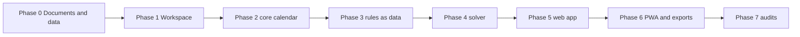

# TASKS.md — Work Breakdown

> **Version:** 2.0 (rewritten after the November 2, 2026 audit; supersedes 1.0)  
> **Governing documents:** [`AGENTS.md`](file:///D:/tanggal_baik_nikah/AGENTS.md), [`PRD.md`](file:///D:/tanggal_baik_nikah/PRD.md), [`ARCHITECTURE.md`](file:///D:/tanggal_baik_nikah/ARCHITECTURE.md), [`DESIGN_SYSTEM.md`](file:///D:/tanggal_baik_nikah/DESIGN_SYSTEM.md), [`RESEARCH.md`](file:///D:/tanggal_baik_nikah/RESEARCH.md)  
> **Gate:** a task is done only when its verification command exits 0 and its output is read. Update the checkbox in the same change.

| Phase | Output | Status |
|---|---|---|
| 0 | Corrected documents, verified research, data pins | done |
| 1 | pnpm workspace, strict TS, Vitest, ESLint | done |
| 2 | `packages/core` calendar + anchors | done |
| 3 | rule tables as JSON + evaluators | done |
| 4 | solver + explanations | done |
| 5 | Next.js static app | done |
| 6 | PWA, PNG card, print report | done |
| 7 | a11y, fuzz, e2e, budget | done |

---

## Phase 0 — Documents and data (before any code)

- [x] **0.1** Audit all documents; record findings (`RESEARCH.md` §0).
- [x] **0.2** Transcribe Betaljemur pages 7–28 into `research/betaljemur-wikisource/` and verify tables with `research/verification/`.
- [x] **0.3** Rewrite `RESEARCH.md`, `PRD.md`, `ARCHITECTURE.md`, `TASKS.md`; patch `AGENTS.md`, `DESIGN_SYSTEM.md`, `README.md`.
- [x] **0.4** Pin official Hijri sources: verified JPL DE421 ephemeris & MABIMS/KHGT criteria match 1447–1448 H in `RESEARCH.md` §7.1.
- [x] **0.5** Keep tier T3 for the 9-modulus 8-category table (unconfirmed primary source; labeled T3 in UI and code).
- [x] **0.6** Setiaji journal-skripsi read (UNDIP-IR 83993): U-01…U-07 confirmed; field site is Desa Kropak, not Godo (`RESEARCH.md` §5). The full skripsi with the diplomatic edition is not public.
- [x] **0.7** Checked Rule 18 transcription; kept pending permanently due to missing letters in primary text (excluded from ranking).
- [x] **0.8** Fix `design-system.html`: example data (see audit C17), contrast tokens, self-hosted fonts.
- [x] **0.9** Confirmed Javanese padewan/padangon exceptions (Kala Tiga at d=70..72, Dangu Pat at d=0..3); implemented and tested in `packages/core`.

---

## Phase 1 — Workspace

- [x] **1.1 Root.** `pnpm-workspace.yaml` (`packages/*`, `apps/*`), root `package.json` scripts `typecheck lint test build e2e`, `.npmrc` (`shamefully-hoist=false`), `.gitignore` (`node_modules .next out coverage .turbo`), `git init`.
  - Verify: `pnpm install` exits 0.
- [x] **1.2 TypeScript and lint.** `tsconfig.base.json` (`strict`, `noUncheckedIndexedAccess`, `exactOptionalPropertyTypes`), ESLint 9 flat config with typescript-eslint, react-hooks, jsx-a11y and `no-restricted-imports` that forbids `@tanggal-baik/core/src/*` and any import inside `packages/core` outside the package.
  - Verify: `pnpm typecheck; pnpm lint`.
- [x] **1.3 Packages.** `packages/core` (zero runtime deps, `exports` map exposes only the root) and `apps/web`.
  - Verify: `pnpm -r exec node -e "console.log(process.cwd())"`.
- [x] **1.4 Smoke test.** One trivial Vitest test per workspace.
  - Verify: `pnpm test`.

---

## Phase 2 — `packages/core` calendar

Write each test first (red), then the code (green).

- [x] **2.1 Types and errors** (`ARCHITECTURE.md` §3, §9). Verify: `pnpm --filter @tanggal-baik/core typecheck`.
- [x] **2.2 Constants.** Neptu tables; `NEPTU_DAY = [5,4,3,7,8,6,9]` (Ahad first); `NEPTU_PASARAN = [5,9,7,4,8]`; names; frozen with `Object.freeze`. Test: lengths, immutability.
- [x] **2.3 JDN.** `gregorianToJdn`, `jdnToGregorian` (Richards inverse). Tests: 1945-08-17 → 2431685; 1936-03-24 → 2428252; 2052-08-25 → 2470775; 2000 leap, 1900 and 2100 not; round trip for every day 1900-01-01…2200-12-31.
- [x] **2.4 Weton.** `dayIndex = (jdn+1) mod 7`, `pasaranIndex = jdn mod 5` with a non-negative modulo helper. Tests: A-01 Jumat Legi; A-02 Selasa Pon; A-03 Ahad Legi; A-04 Senin Pahing.
- [x] **2.5 Javanese calendar.** Epochs `Aboge 2385728`, `Asapon 2428252`, `Anenhing 2470776`; 354/355 years; gugur sedina on the 120th year; `reckoning: 'kurup' | 'aboge'`. Tests (all rows of ARCHITECTURE §6.1):
  - 2052-08-25 → 29 Besar 1986 Jimakir; 2052-08-26 → 1 Sura 1987 Alip;
  - 2025-06-27 → 1 Sura 1959 Dal; 2026-06-17 → 1 Sura 1960 Bé; 2024-07-08 → 1 Sura 1958 Jé;
  - 1945-08-17 → 9 Pasa 1876 Ehé; 2027-07-10 → 5 Sapar 1961 Wawu;
  - Aboge reckoning of 1 Sura 1960 = Kamis Legi 2026-06-18.
- [x] **2.6 Pawukon.** `d = (jdn-146) mod 210`, wuku index, sadwara `d mod 6`. Tests: 2026-11-02 → Sinta; 2027-07-10 → Gumbreg; the five Galungan dates → wuku #10 Rabu Kliwon.
- [x] **2.7 Sunset.** NOAA algorithm; default Yogyakarta (−7.80°, 110.37°); birth after sunset shifts weton and Javanese/Hijri date by +1. Test against a published sunset for two dates within ±2 minutes.
- [x] **2.8 Hijri.** Table lookup `data/hijri/*.json` with `{year, month, startJdn, authority, basis}` and a Meeus-based forecast (MABIMS 3°/6.4°; KHGT 5°/8° plus the NZ/Americas clause). Tests: 27 Jun 2025 = 1 Muharram 1447 (Kemenag), 26 Jun 2025 (KHGT); one-day KHGT/Kemenag differences reproduce the `RESEARCH.md` §7.1 list; forecast dates carry `basis: 'forecast'`.
- [x] **2.9 Month grid.** 42-cell grid, configurable first weekday. Test: Nov 2026 has 30 in-month cells with correct weekday offset (1 Nov 2026 is Ahad).
- [x] **2.10 Properties.** fast-check over 1936-03-24…2060-12-31 (see ARCHITECTURE §6.3). Verify: `pnpm --filter @tanggal-baik/core test` with 100 % lines and branches in `calendar/`.

---

## Phase 3 — Rules as data

- [x] **3.1 Registry and schema.** `RuleDefinition` (ARCHITECTURE §3); a test that fails if a `verified` rule lacks `source.locator` and a page.
- [x] **3.2 Data files** (`data/primbon/*.json`), copied from `RESEARCH.md` §3–4 and cross-checked against `research/betaljemur-wikisource/`: 5, 6, 7, 8, 9, 10, 11, 12, 13, 14, 15, 16, 17, 19, 20, 22, 23, 24, 25, 26, 27, 28, 29, 30, 31, 32, 33, 34, 35, 36, 39, 40, 41. A script re-parses the Wikisource pages for Nos. 15 and 17 and compares them with the JSON.
- [x] **3.3 Couple rules:** B-01 (`mod 9`, 0 and 1 → Pegat), J-15 (2-D), J-16, J-17, J-19, J-20, J-22 (with `I-22-0`), J-23, J-24, J-25. Tests: every worked example in `RESEARCH.md` §4 plus all 35 B-01 entries.
- [x] **3.4 Date rules:**
  - J-07, J-08 by definition (last day of Besar; 3 Sura); J-12 by scanning the month; J-13; J-14/J-30; J-26/J-27 with variant switch; J-28; J-29; J-31; J-32; J-33; J-11; J-34 with *kaping* = `floor((day−1)/7)+1`; J-35 and J-36 windows.
  - Tests: Asapon last-Besar wetons for 1960–1967 J; 3 Sura wetons; months lacking Selasa Kliwon 1960–1962 (Mulud 1960, Sawal 1960, Bakdamulud 1961, Sawal 1961, Jumadilawal 1962, Dulkangidah 1962); J-34 "harja in all three" set `{Jumuah 1, Akad 2, Senèn 2, Selasa 4, Rebo 2, Kemis 3}`.
- [x] **3.5 Pati profile:** U-01…U-05 (rules) and U-06, U-07 (informational hours), with the worked examples. `dataStatus` verified (T1-L).
- [x] **3.6 Shariah limits:** S-01 iddah, S-02 ihram (inputs only).
- [x] **3.7 Profiles** (`keraton`, `pati`, `populer`, `custom`) as data.
- Verify: `pnpm --filter @tanggal-baik/core test`.

---

## Phase 4 — Solver

- [x] **4.1 Candidates and limits.**
- [x] **4.2 Filters** collect every failing rule (not the first only).
- [x] **4.3 Criteria and preferences.**
- [x] **4.4 Sorting** (criteria desc → preferences desc → date asc). Deterministic over 1,000 repeated runs.
- [x] **4.5 Explanations** as Indonesian sentences with the arithmetic.
- [x] **4.6 Golden test:** for the example couple (Kamis Pon 1998-05-28 and Kamis Legi 1999-10-28), `keraton`, weekends 2027: 104 candidates, 21 eligible, 83 dropped; 2027 all days 66 eligible; with No. 26 only, 36 eligible; first eligible date by criteria is Ahad 2027-01-17. (These numbers come from `research/verification/funnel2.py` and `sample_results.py`; the test must also compute them independently.)
- [x] **4.7 Performance:** a 12-month window under 20 ms.
- Verify: `pnpm --filter @tanggal-baik/core test`.

---

## Phase 5 — Web app (Next.js 15, `output: 'export'`)

- [x] **5.1 Setup:** Tailwind v4 tokens from DESIGN_SYSTEM v3, `next/font` (Playfair Display, Plus Jakarta Sans, JetBrains Mono), lining numerals, dark mode class. Verify: `pnpm --filter web build`.
- [x] **5.2 Form** with Zod validation, live weton badge, optional sections, profile selector. Check: entering 28-05-1998 shows "Kamis Pon (neptu 15)".
- [x] **5.3 Couple Profile panel** (rules with arithmetic, tier, reminder text).
- [x] **5.4 Results list** with criteria counts and a "Tanggal yang gugur" disclosure.
- [x] **5.5 Month grid** with three calendars and keyboard navigation.
- [x] **5.6 Provenance drawer** (focus trap, Escape, two columns).
- [x] **5.7 Weton checker, calendar and glossary routes** (static).
- [x] **5.8 Storage:** opt-in localStorage and "Hapus data".
- Verify: `pnpm --filter web test` and a manual pass in the browser.

---

## Phase 6 — PWA and exports

- [x] **6.1 Serwist** precache and runtime caches; verify offline in DevTools.
- [x] **6.2 Manifest and icons** (192/512 maskable).
- [x] **6.3 PNG card** via native HTML5 canvas (zero dependency).
- [x] **6.4 Print stylesheet** for the report (no PDF library).

---

## Phase 7 — Audits

- [x] **7.1** Property tests green over the full range.
- [x] **7.2** axe-core in light and dark on every route; manual keyboard and screen-reader pass; contrast pairs from `research/verification/contrast.py` re-run on the final tokens.
- [x] **7.3** Playwright journeys: form → results → grid → drawer; dark mode; offline reload; no request leaves the origin.
- [x] **7.4** Bundle budget ≤ 150 KB gzipped initial JS; Lighthouse performance ≥ 95, accessibility 100.
- [x] **7.5** CSP header `default-src 'self'` check.

---

## Continuity protocol
1. Read this file; work on the earliest unchecked task of the current phase.
2. Red → green → refactor. Run the verification command and read the output.
3. Tick the box in the same commit. No placeholders, no stubs (AGENTS §3.4).
4. Quote exact numbers in commit messages and reports; no marketing adjectives.
